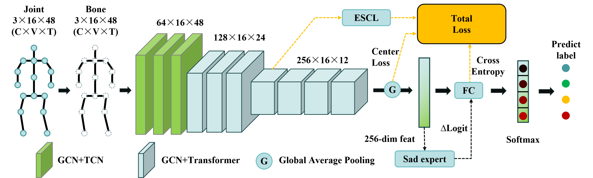

# CTR-Gait: Semantic-Aware Contrastive Learning for Fine-Grained Gait Emotion Recognition

<!-- `https://img.shields.io/badge/License-MIT-yellow.svg` ](https://opensource.org/licenses/MIT) -->
<!-- `https://img.shields.io/badge/PyTorch-1.8%2B-orange` ]( `https://pytorch.org/)`  -->

This repository contains the official PyTorch implementation of the paper: **"CTR-Gait: Semantic-Aware Contrastive Learning for Fine-Grained Gait Emotion Recognition"** (Submitted to *IEEE Transactions on Affective Computing*).

## 🚀 Introduction

CTR-Gait is a lightweight yet robust framework designed to capture subtle affective cues from skeletal gait sequences. It addresses the challenge of distinguishing fine-grained emotions (e.g., Sadness vs. Neutral) through semantic-aware contrastive learning and topological refinement.

**Key Achievements:**
- **State-of-the-Art Accuracy:** Achieves **92.66%** on the Emotion-Gait benchmark.
- **Efficiency:** Ultra-lightweight design with **0.39 GFLOPs** and **3.76 M parameters**.
- **Robustness:** Validated on real-world UAV-captured datasets with high stability.

**Core Components:**
- **CTR-Graph**: Channel-wise Topology Refined Graph Convolutions to capture dynamic spatial correlations.
- **ESCL**: Emotion-Semantic Contrastive Learning with learnable Valence-Arousal centers.
- **SadExpert**: A specialized expert module to refine predictions for the minority "Sad" class.


*(Figure: Overview of the CTR-Gait Framework)*

## 📂 Project Structure

```text
CTR-Gait/
├── configs/                 # Configuration files for experiments
│   ├── bone_escl.yaml       # Main config for Bone modality + ESCL
│   └── ...
├── data/                    # Data processing scripts
│   └── generate_bpm_complete_data.py
├── src/                     # Source code
│   ├── dataset/             # Data loaders
│   ├── model/               # Model definitions (CTR-GCN, Transformer, etc.)
│   └── processor.py         # Training and testing loops
├── weights/                 # Directory to save/load pre-trained models
├── main.py                  # Main entry point
├── requirements.txt         # Python dependencies
└── README.md
```

## 🛠️ Installation

Clone the repository:
(Note: Use the anonymous link provided in the paper during the review process)

```bash
git clone [https://github.com/yeaoshuang/CTR-Gait]
cd CTR-Gait
```

Install dependencies:

Python >= 3.8

PyTorch >= 1.8

```bash
pip install -r requirements.txt
```

## 💾 Data Preparation

### 1. Download Dataset

Please download the Emotion-Gait dataset from [\[INSERT DATASET LINK HERE\]](https://github.com/exped1230/BPM-GCN).

### 2. Organize Directory

Place the raw data in the data/ folder. The structure should look like this:

```
data/
└── emotion_gait/
    ├── raw_data/            # Put original .npy or .txt files here
    └── ...
```

### 3. Preprocessing

Run the generation script to create bone vectors and motion data (BPM):

```bash
python data/generate_bpm_complete_data.py
```

This will generate the processed .npz files required for training in the data/ directory.

## 🏃 Usage

### Training

To train the CTR-Gait model using Bone modality with ESCL enabled:

```bash
python main.py --config configs/bone_escl.yaml
```

Check points will be saved in the work_dir specified in the config file.

### Evaluation

To evaluate a pre-trained model on the test set:

```bash
python main.py --config configs/bone_escl.yaml --evaluate --weights weights/bone_escl_CTRGCN_bone.pth
```

> Expected Result: Accuracy ~92.66%

### Customization

You can modify parameters in configs/bone_escl.yaml:

- batch_size: Adjust according to your GPU memory.
- step: Learning rate decay steps.
- base_lr: Initial learning rate.

## 📊 Model Zoo

We provide pre-trained weights to reproduce the reported results.

| Model | Modality | Accuracy | GFLOPs | Params | Download |
|-------|----------|----------|--------|--------|----------|
| CTR-Gait | Bone | 92.66% | 0.39G | 3.76M | https://github.com/yeaoshuang/CTR-Gait/releases/tag/v1.0 |

(Note: Download link ensures anonymity for peer review)

## ⚖️ License

This project is licensed under the MIT License - see the LICENSE file for details.

## 📝 Citation

If you find this work useful for your research, please cite:

(Citation details will be updated upon acceptance)

